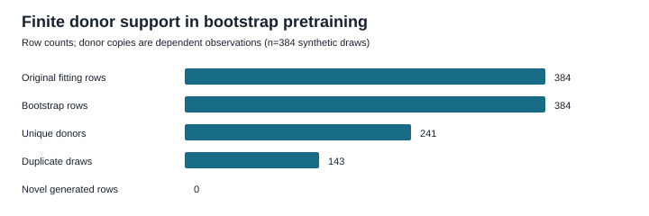
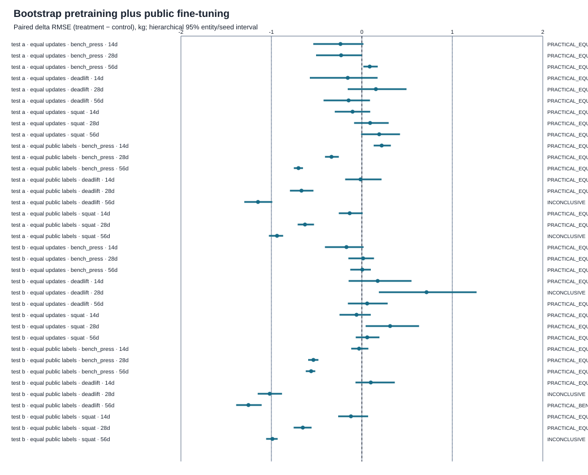

# Synthetic pretraining transfer: RES-292

Study: psr:study:synthetic-pretraining-transfer-public-native@1.0.0~e6209a7185e8 
Protocol digest: sha256:e6209a7185e826e4b041c7b2aac7b313ae10cc98d83496db5edb528fc20d1e96 
Dataset realization: psr:dataset-realization:synthetic-pretraining-transfer-public-native@sha256:2162e1085cdd11c5c054b51c410f6ad82882e1739098e3838d486fe912666396 
Realization digest: sha256:2162e1085cdd11c5c054b51c410f6ad82882e1739098e3838d486fe912666396 
Evaluation: res292-public-native-synthetic-pretraining-transfer-v1 
Classification: NEW_PUBLIC_NATIVE_EXPERIMENT

This study executes Linear RES-292 as a new experiment. Historical G4 / ALI-544
survives as study metadata and aliases; no original G4 method, model, score,
report, or negative result was recovered. Nothing in this report is attributed
to historical G4. See [historical lineage](../../../studies/synthetic_pretraining_transfer/historical-lineage.md)
and the frozen [protocol](../../../studies/synthetic_pretraining_transfer/protocol.json).

## Scope and information boundary

Here “real” means a held-out row from the public-native synthetic benchmark's
original generating distribution. The test populations are synthetic; this is
not real-athlete transfer. The learner receives only authorized fitting
records and unlabeled development/test inputs. Evaluation targets, source
equations, latent states, population coordinates, exact parameter bounds,
private material, and authority-only keys stay outside the learner. Prediction
bytes were sealed before the authority joined test truth. The firewall audit,
payload digests, and exact source hashes are in
[learner-input-audit.json](learner-input-audit.json).

Fitting, development, test A, and test B each use independent population,
intervention, observation, and split seeds and disjoint opaque entity IDs.
There are 384 public fitting rows, 192 development rows, and two independent
384-row test populations, balanced over four plans and three horizons. The
fitting rows have three lift-specific targets in kg. Development predictions
are learning-curve checks only; they do not select hyperparameters or stopping
points.

## Synthetic label provenance

The empirical bootstrap drew 384 complete records from
241 unique public fitting donors. Its duplicate
draw fraction is 0.372; the exact donor-copy
fraction is 1.000. Bootstrap targets are
BOOTSTRAP_DUPLICATE_LABEL values copied with their donor rows. The separate
SURROGATE_PSEUDO_LABEL rows copy donor inputs and use cross-fitted Summary Ridge
predictions. ORIGINAL_PUBLIC_LABEL values remain attached to the original
training rows. Pseudo-labels are conditional model predictions, not source
truth. The study generated no novel participant rows and no independently
generated source-truth labels.

Exact donor lineage, teacher folds and coefficients, per-target label
provenance, and duplicate counts are in [donor-lineage.jsonl](synthetic/donor-lineage.jsonl),
[teacher-crossfit.jsonl](synthetic/teacher-crossfit.jsonl), and
[training-label-provenance.csv](synthetic/training-label-provenance.csv).
Held-out sample-extrema and nearest-donor metrics are in
[sample-geometry.csv](sample-geometry.csv) and
[support-coverage.csv](support-coverage.csv). They describe this finite
realization and do not estimate population bounds.

## Frozen arms and compute controls

Every arm uses the same fixed 58-input, three-output linear model with 177
parameters, initialization, optimizer, feature map, 32-row batches, and
learning rate. The six declared arms separate donor-copy labels from surrogate
pseudo-labels. PUBLIC_ONLY and each fine-tuning phase expose the same 4,096
public row-label presentations. COMPUTE_MATCHED_PUBLIC_ONLY uses the same 256
optimizer updates and 8,192 total row presentations as bootstrap pretraining
plus fine-tuning, but spends them on public rows. This gives a public-label
exposure-matched contrast and a separate update-matched contrast. Teacher-fit
work is counted separately for pseudo-label arms.

Exact per-seed learner states and instance IDs are in
[fitted-models.json](fitted-models.json) and
[fitted-instance-identities.json](fitted-instance-identities.json).
[Compute accounting](compute-accounting.csv) records every update, row
presentation, teacher fit, parameter count, and failed fit. The
[development learning curves](development-learning-curves.csv) retain each
arm, target, lift, horizon, and training seed.

## Predictive utility and transfer

Metrics are RMSE, MAE, and signed bias in kg, reported separately by arm,
population, lift, horizon, and fitting seed. The complete cell-level table is
[evaluation-results.csv](evaluation-results.csv); exact sealed predictions
are [predictions.jsonl](predictions.jsonl). Five fitting seeds are retained.
No score is pooled across lifts, targets, or horizons in the primary results.
The following compact table shows direct-public, donor-bootstrap-only, and
pseudo-label-only RMSE as the mean and range across the five fitting seeds for
each target/lift/horizon. The pseudo-label-only student sees copied inputs and
surrogate predictions derived from public training labels; it is not an
independent synthetic-only label source. Per-seed rows remain in the results table.

| Population | Lift | Horizon | Public only | Bootstrap only | Pseudo-label only |
| --- | --- | ---: | ---: | ---: | ---: |
| test_population_a | bench_press | 14 days | 1.753 (1.636–2.136) | 2.211 (1.621–2.678) | 1.988 (1.751–2.172) |
| test_population_a | bench_press | 28 days | 2.557 (2.469–2.789) | 2.763 (2.415–3.072) | 2.889 (2.689–3.011) |
| test_population_a | bench_press | 56 days | 5.849 (5.680–5.951) | 5.886 (5.844–5.945) | 6.096 (6.079–6.153) |
| test_population_a | deadlift | 14 days | 4.785 (4.586–5.044) | 5.083 (4.525–6.045) | 4.909 (4.735–5.003) |
| test_population_a | deadlift | 28 days | 5.893 (5.541–6.331) | 5.733 (5.373–6.345) | 5.972 (5.921–6.029) |
| test_population_a | deadlift | 56 days | 8.037 (7.893–8.155) | 8.236 (7.770–8.981) | 8.512 (8.452–8.600) |
| test_population_a | squat | 14 days | 3.402 (3.271–3.551) | 3.762 (3.293–4.331) | 3.532 (3.499–3.575) |
| test_population_a | squat | 28 days | 5.301 (5.155–5.499) | 5.431 (5.101–6.044) | 5.512 (5.455–5.567) |
| test_population_a | squat | 56 days | 7.963 (7.696–8.308) | 7.936 (7.692–8.666) | 8.168 (8.086–8.316) |
| test_population_b | bench_press | 14 days | 1.981 (1.884–2.152) | 2.230 (1.873–2.578) | 2.166 (2.012–2.286) |
| test_population_b | bench_press | 28 days | 3.909 (3.825–4.052) | 3.940 (3.922–3.994) | 4.146 (4.083–4.178) |
| test_population_b | bench_press | 56 days | 5.492 (5.443–5.554) | 5.647 (5.460–5.801) | 5.751 (5.687–5.795) |
| test_population_b | deadlift | 14 days | 3.894 (3.456–4.500) | 3.864 (3.368–4.646) | 3.735 (3.682–3.781) |
| test_population_b | deadlift | 28 days | 7.755 (7.140–8.474) | 7.153 (6.963–7.587) | 7.735 (7.655–7.944) |
| test_population_b | deadlift | 56 days | 7.958 (7.662–8.287) | 7.825 (7.484–8.406) | 8.237 (8.195–8.277) |
| test_population_b | squat | 14 days | 3.563 (3.402–3.741) | 3.843 (3.393–4.478) | 3.632 (3.589–3.682) |
| test_population_b | squat | 28 days | 6.400 (6.106–6.724) | 6.417 (6.151–7.422) | 6.531 (6.456–6.721) |
| test_population_b | squat | 56 days | 8.997 (8.860–9.200) | 9.058 (8.830–9.458) | 9.296 (9.245–9.363) |

Paired uncertainty resamples held-out entities within each plan and horizon,
using the same sampled entities for both arms. The pooled interval first
resamples fitting seeds and then entities. The practical RMSE margin was fixed
at ±1.0 kg before fitting. An interval wholly below −1.0 kg is
PRACTICAL_BENEFIT; wholly above +1.0 kg is PRACTICAL_HARM; wholly within the
margin is PRACTICAL_EQUIVALENCE; other cells remain INCONCLUSIVE.

Status counts below summarize the 18 predeclared lift/horizon cells per
population; they are a count of resolved cells, not a universal leaderboard.
The full per-seed and pooled contrasts, including pseudo-label arms, are in
[paired-transfer-effects.csv](paired-transfer-effects.csv).

| Contrast (treatment − control) | Population | Benefit | Harm | Equivalent | Inconclusive | Fit failed |
| --- | --- | ---: | ---: | ---: | ---: | ---: |
| SYNTHETIC_ONLY_BOOTSTRAP − PUBLIC_ONLY | test_population_a | 0 | 0 | 8 | 1 | 0 |
| SYNTHETIC_ONLY_BOOTSTRAP − PUBLIC_ONLY | test_population_b | 0 | 0 | 8 | 1 | 0 |
| SYNTHETIC_PRETRAIN_PUBLIC_FINETUNE_BOOTSTRAP − PUBLIC_ONLY | test_population_a | 0 | 0 | 7 | 2 | 0 |
| SYNTHETIC_PRETRAIN_PUBLIC_FINETUNE_BOOTSTRAP − PUBLIC_ONLY | test_population_b | 1 | 0 | 6 | 2 | 0 |
| SYNTHETIC_PRETRAIN_PUBLIC_FINETUNE_BOOTSTRAP − COMPUTE_MATCHED_PUBLIC_ONLY | test_population_a | 0 | 0 | 9 | 0 | 0 |
| SYNTHETIC_PRETRAIN_PUBLIC_FINETUNE_BOOTSTRAP − COMPUTE_MATCHED_PUBLIC_ONLY | test_population_b | 0 | 0 | 8 | 1 | 0 |
| SYNTHETIC_ONLY_PSEUDOLABEL − PUBLIC_ONLY | test_population_a | 0 | 0 | 9 | 0 | 0 |
| SYNTHETIC_ONLY_PSEUDOLABEL − PUBLIC_ONLY | test_population_b | 0 | 0 | 9 | 0 | 0 |
| SYNTHETIC_PRETRAIN_PUBLIC_FINETUNE_PSEUDOLABEL − PUBLIC_ONLY | test_population_a | 0 | 0 | 9 | 0 | 0 |
| SYNTHETIC_PRETRAIN_PUBLIC_FINETUNE_PSEUDOLABEL − PUBLIC_ONLY | test_population_b | 0 | 0 | 8 | 1 | 0 |
| SYNTHETIC_PRETRAIN_PUBLIC_FINETUNE_PSEUDOLABEL − COMPUTE_MATCHED_PUBLIC_ONLY | test_population_a | 0 | 0 | 9 | 0 | 0 |
| SYNTHETIC_PRETRAIN_PUBLIC_FINETUNE_PSEUDOLABEL − COMPUTE_MATCHED_PUBLIC_ONLY | test_population_b | 0 | 0 | 8 | 1 | 0 |

| Test population | Control | Lift | Horizon | Δ RMSE, kg | Hierarchical 95% interval, kg | Status |
| --- | --- | --- | ---: | ---: | --- | --- |
| test_population_a | COMPUTE_MATCHED_PUBLIC_ONLY | bench_press | 14 | -0.236 | [-0.537, 0.017] | PRACTICAL_EQUIVALENCE |
| test_population_a | COMPUTE_MATCHED_PUBLIC_ONLY | bench_press | 28 | -0.229 | [-0.506, -0.000] | PRACTICAL_EQUIVALENCE |
| test_population_a | COMPUTE_MATCHED_PUBLIC_ONLY | bench_press | 56 | 0.087 | [0.016, 0.176] | PRACTICAL_EQUIVALENCE |
| test_population_a | COMPUTE_MATCHED_PUBLIC_ONLY | deadlift | 14 | -0.155 | [-0.575, 0.174] | PRACTICAL_EQUIVALENCE |
| test_population_a | COMPUTE_MATCHED_PUBLIC_ONLY | deadlift | 28 | 0.155 | [-0.156, 0.494] | PRACTICAL_EQUIVALENCE |
| test_population_a | COMPUTE_MATCHED_PUBLIC_ONLY | deadlift | 56 | -0.146 | [-0.423, 0.090] | PRACTICAL_EQUIVALENCE |
| test_population_a | COMPUTE_MATCHED_PUBLIC_ONLY | squat | 14 | -0.103 | [-0.299, 0.092] | PRACTICAL_EQUIVALENCE |
| test_population_a | COMPUTE_MATCHED_PUBLIC_ONLY | squat | 28 | 0.091 | [-0.086, 0.297] | PRACTICAL_EQUIVALENCE |
| test_population_a | COMPUTE_MATCHED_PUBLIC_ONLY | squat | 56 | 0.192 | [-0.009, 0.422] | PRACTICAL_EQUIVALENCE |
| test_population_a | PUBLIC_ONLY | bench_press | 14 | 0.219 | [0.131, 0.321] | PRACTICAL_EQUIVALENCE |
| test_population_a | PUBLIC_ONLY | bench_press | 28 | -0.336 | [-0.408, -0.254] | PRACTICAL_EQUIVALENCE |
| test_population_a | PUBLIC_ONLY | bench_press | 56 | -0.701 | [-0.752, -0.651] | PRACTICAL_EQUIVALENCE |
| test_population_a | PUBLIC_ONLY | deadlift | 14 | -0.014 | [-0.184, 0.217] | PRACTICAL_EQUIVALENCE |
| test_population_a | PUBLIC_ONLY | deadlift | 28 | -0.668 | [-0.795, -0.535] | PRACTICAL_EQUIVALENCE |
| test_population_a | PUBLIC_ONLY | deadlift | 56 | -1.148 | [-1.300, -0.990] | INCONCLUSIVE |
| test_population_a | PUBLIC_ONLY | squat | 14 | -0.134 | [-0.255, 0.009] | PRACTICAL_EQUIVALENCE |
| test_population_a | PUBLIC_ONLY | squat | 28 | -0.629 | [-0.709, -0.529] | PRACTICAL_EQUIVALENCE |
| test_population_a | PUBLIC_ONLY | squat | 56 | -0.938 | [-1.028, -0.870] | INCONCLUSIVE |
| test_population_b | COMPUTE_MATCHED_PUBLIC_ONLY | bench_press | 14 | -0.170 | [-0.408, 0.019] | PRACTICAL_EQUIVALENCE |
| test_population_b | COMPUTE_MATCHED_PUBLIC_ONLY | bench_press | 28 | 0.014 | [-0.149, 0.134] | PRACTICAL_EQUIVALENCE |
| test_population_b | COMPUTE_MATCHED_PUBLIC_ONLY | bench_press | 56 | 0.005 | [-0.128, 0.099] | PRACTICAL_EQUIVALENCE |
| test_population_b | COMPUTE_MATCHED_PUBLIC_ONLY | deadlift | 14 | 0.175 | [-0.146, 0.548] | PRACTICAL_EQUIVALENCE |
| test_population_b | COMPUTE_MATCHED_PUBLIC_ONLY | deadlift | 28 | 0.715 | [0.188, 1.268] | INCONCLUSIVE |
| test_population_b | COMPUTE_MATCHED_PUBLIC_ONLY | deadlift | 56 | 0.059 | [-0.155, 0.285] | PRACTICAL_EQUIVALENCE |
| test_population_b | COMPUTE_MATCHED_PUBLIC_ONLY | squat | 14 | -0.058 | [-0.247, 0.099] | PRACTICAL_EQUIVALENCE |
| test_population_b | COMPUTE_MATCHED_PUBLIC_ONLY | squat | 28 | 0.312 | [0.042, 0.633] | PRACTICAL_EQUIVALENCE |
| test_population_b | COMPUTE_MATCHED_PUBLIC_ONLY | squat | 56 | 0.060 | [-0.068, 0.194] | PRACTICAL_EQUIVALENCE |
| test_population_b | PUBLIC_ONLY | bench_press | 14 | -0.031 | [-0.118, 0.072] | PRACTICAL_EQUIVALENCE |
| test_population_b | PUBLIC_ONLY | bench_press | 28 | -0.535 | [-0.594, -0.480] | PRACTICAL_EQUIVALENCE |
| test_population_b | PUBLIC_ONLY | bench_press | 56 | -0.560 | [-0.620, -0.515] | PRACTICAL_EQUIVALENCE |
| test_population_b | PUBLIC_ONLY | deadlift | 14 | 0.098 | [-0.070, 0.365] | PRACTICAL_EQUIVALENCE |
| test_population_b | PUBLIC_ONLY | deadlift | 28 | -1.019 | [-1.151, -0.882] | INCONCLUSIVE |
| test_population_b | PUBLIC_ONLY | deadlift | 56 | -1.254 | [-1.390, -1.107] | PRACTICAL_BENEFIT |
| test_population_b | PUBLIC_ONLY | squat | 14 | -0.120 | [-0.262, 0.069] | PRACTICAL_EQUIVALENCE |
| test_population_b | PUBLIC_ONLY | squat | 28 | -0.653 | [-0.754, -0.556] | PRACTICAL_EQUIVALENCE |
| test_population_b | PUBLIC_ONLY | squat | 56 | -0.989 | [-1.058, -0.931] | INCONCLUSIVE |

## Negative and inconclusive findings

[Negative-results.csv](negative-results.csv) preserves the historical evidence
limit, every paired cell state, finite-support interpretation, and prohibited
claims. A resolved or inconclusive result applies only to this frozen learner,
realization, and target cell. Repeated public donors do not add independent
information about the source world. A transfer gain over PUBLIC_ONLY alone
does not show incremental value beyond additional public optimization; the
compute-matched contrast is reported separately. A lack of observed benefit
does not establish that all synthetic pretraining is ineffective.

Source-to-target label distribution discrepancies are in
[source-target-discrepancy.csv](source-target-discrepancy.csv). They compare
finite training/synthetic rows with same-law held-out entities by population,
lift, and horizon; they do not prove source-system recovery or structural
equivalence.

| Arm | Fit seed | Status | Failure |
| --- | ---: | --- | --- |
| None | — | NO_FIT_FAILURES | All frozen learner fits completed. |

No causal training effect, real-athlete transfer, or source-system
identification is claimed.

## Reproduction, claims, and rights

Replay the frozen realization, learner runs, tables, figures, report, and
hashes from the repository root:

    uv run --locked python -m powerlifting_state_research.studies.synthetic_pretraining_transfer
    uv run --locked python -m powerlifting_state_research.studies.synthetic_pretraining_transfer --check

[claims.json](claims.json) binds each quantitative claim family to source
artifacts, protocol digest, realization, evaluation identity, and fitted
instance identities. [manifest.json](manifest.json),
[artifact-manifest.json](artifact-manifest.json), and
[SHA256SUMS.txt](SHA256SUMS.txt) contain the artifact and checksum indexes.
New code and machine-readable results are MIT; authored prose and this report
are CC BY 4.0. No private historical artifact was used.

## RES-293 handoff

RES-292 hands off a new, same-distribution synthetic study with donor-copy and
cross-fitted pseudo-label treatments. A later RES-293 may ask whether a
separately specified synthetic source with genuinely novel support and
authorized labels adds predictive value under the same public-label and
compute controls. It must freeze its generator, label authority, targets,
splits, and practical margin before fitting. This handoff does not execute
RES-293 and does not change RES-293 or RES-294.
