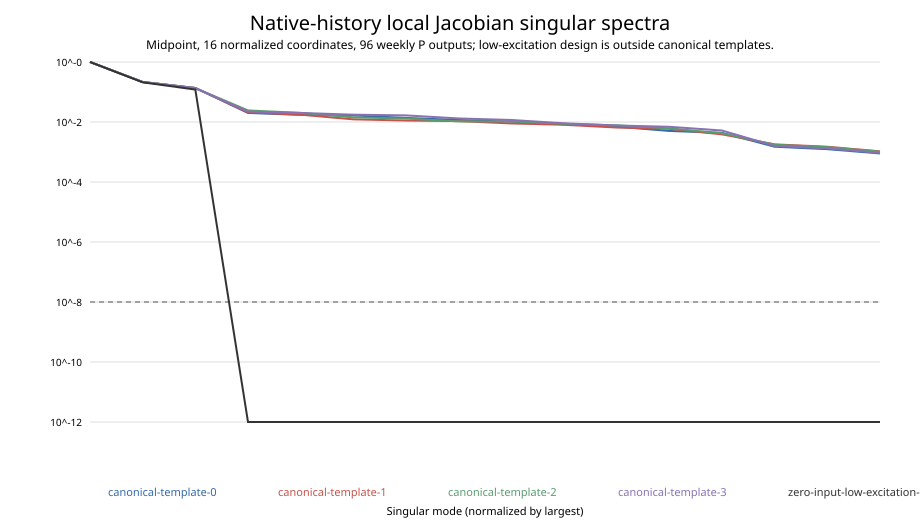
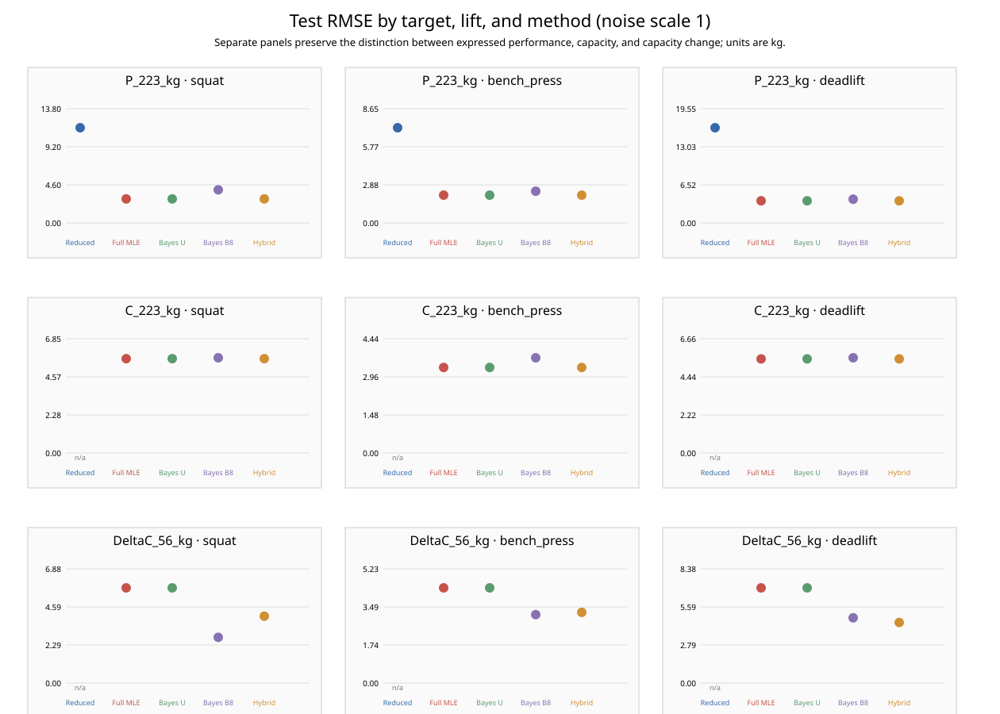
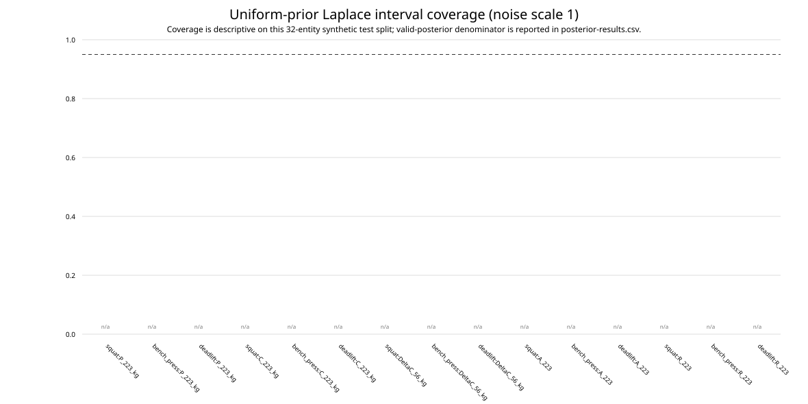

# Structural reconstruction and system identification

Study `psr:study:target-sufficient-structural-reconstruction-public-native@1.0.0~12aafcbac716`; frozen protocol `sha256:12aafcbac716350e46002178918fe1ee08f65c2f76167368f7ed6cb4a8e0f405`; public-native realization `psr:study-realization:target-sufficient-structural-reconstruction-public-native@sha256:345de0028b7beeefdc355bf7112565bad2d5675e5bbed3a5c5901371436b5af1`; evaluation `res289-target-wise-evaluation-v1`. The [manifest](manifest.json) binds source, truth, observation, split, estimator, protocol, evaluation, and output identities. This is a new synthetic study, not a recovery of original G2 results.

## Historical G2 evidence

The surviving record verifies the G2 study name, retrospective purpose, and aliases `G2 / ALI-542` and `pl_study_g2_structural_reconstruction`. No rights-cleared original protocol, measurements, fitted models, uncertainty, or quantitative results survive. The old `PROVEN` marker is bootstrap metadata, not a scientific result. No original G2 result is invented or recomputed. See [historical-lineage.md](../../../studies/target_sufficient_structural_reconstruction/historical-lineage.md).

## Frozen design and evidence boundary

The protocol was frozen before the study realization was generated. It uses the known public M2 daily law and coordinate transforms, the native zero-initial-state assumption, four M3 weekly history templates, and the four declared future plans. It generated 64 independent entities with a 32-entity development set and a 32-entity held-out test set. All entities, schedules, and plans are matched across noise scales 0, 1, and 2. The native channels are preserved; all four estimator families use assessment history only, and the same declared schedules.

The three public observation channels share the same expressed-performance source. The structural fit uses the assessment marginal likelihood conditioned on the native accepted-load domain, including the sampled load-fraction overlap and `1/P` density term. Noise-free Bayesian uncertainty is reported as undefined. The frozen [formal specification](../../../studies/target_sufficient_structural_reconstruction/formal-specification.md) gives the likelihood, units, and identifiability claim boundaries.

M2 world identity: `psr:world:world-v2-parsimonious-response-world@1.0.0~a1afbf2f5c1e`. M3 public-native DatasetSpec: `psr:dataset-spec:latent-capacity-transient-iid-sampling-design@1.0.0~1d079eb645ed`; canonical M3 evaluation: `psr:evaluation:iid-latent-capacity-change-four-metric-validation@1.0.0~cd4fe982e7b8`. RES-289's method-by-target evaluation is separate from M3/M4. M4 comparator scores remain forecasting evidence and do not measure latent-state or parameter recovery. M5 validity limitations remain in force.

## Structural identifiability

At one time, assessment, load, and velocity all factor through expressed performance `P`; the two free latent coordinates `A` and `R` therefore have instantaneous output rank at most one. The midpoint local finite-difference diagnostics use 96 weekly `P` outputs and 16 normalized coordinates. Full local rank, if observed, is only local sensitivity at the tested midpoint. The table and singular spectra below do not establish a global inverse.

| Input design | Local rank / 16 | Condition number | Refinement |
| --- | --- | --- | --- |
| canonical-template-0 | 16 / 16 | 1119.38 | 0.0000 |
| canonical-template-1 | 16 / 16 | 952.20 | 0.0000 |
| canonical-template-2 | 16 / 16 | 977.95 | 0.0000 |
| canonical-template-3 | 16 / 16 | 1078.36 | 0.0000 |
| zero-input-low-excitation-sensitivity | 3 / 16 | — | — |

The constant continue design at dose-intensity product `0.6` is outside the four canonical history templates. Recomputing the reference-stimulus/gain transformation gives maximum `P` history difference `0.000000000000 kg`; adaptation and suppression states differ while `C` and `P` remain equal. This is an exact counterexample only for that constant-input design. RES-287's free-initial-state rest analysis is not transferred to the native `A[-1]=R[-1]=0` model. The finite native-template multistart search found `0` candidate equivalent solution pairs; global identification on the canonical templates remains **INCONCLUSIVE**.

## Numerical convergence and observation-noise sensitivity

The solver contract retains each best finite feasible result if none of its four starts converges. Such results are scored but explicitly marked; the entity bootstrap does not include optimization uncertainty. At native and doubled noise, most full-MLE starts did not meet the frozen convergence flag, so their point-error metrics are conditional on the retained finite fits and must be read with the failure counts below.

| Estimator | Prior | Noise | Converged starts | Nonconverged starts | Infeasible starts | Test selected-fit statuses |
| --- | --- | --- | --- | --- | --- | --- |
| bayesian_native_laplace_v1 | beta8 | 1.0 | 128 | 0 | 0 | {"CONVERGED": 32} |
| bayesian_native_laplace_v1 | beta8 | 2.0 | 128 | 0 | 0 | {"CONVERGED": 32} |
| full_bounded_native_mle_v1 | none | 0.0 | 256 | 0 | 0 | {"CONVERGED": 32} |
| full_bounded_native_mle_v1 | none | 1.0 | 7 | 249 | 0 | {"CONVERGED": 2, "NONCONVERGED_BEST_RETAINED": 30} |
| full_bounded_native_mle_v1 | none | 2.0 | 22 | 234 | 0 | {"CONVERGED": 9, "NONCONVERGED_BEST_RETAINED": 23} |

| Estimator | Noise | Target | Lift | n | RMSE | Unit | Status |
| --- | --- | --- | --- | --- | --- | --- | --- |
| Full MLE | 0.0 | C_223_kg | bench_press | 32/32 | 0.0000 | kg | COMPLETE |
| Full MLE | 0.0 | C_223_kg | deadlift | 32/32 | 0.0000 | kg | COMPLETE |
| Full MLE | 0.0 | C_223_kg | squat | 32/32 | 0.0000 | kg | COMPLETE |
| Full MLE | 0.0 | DeltaC_56_kg | bench_press | 32/32 | 0.0000 | kg | COMPLETE |
| Full MLE | 0.0 | DeltaC_56_kg | deadlift | 32/32 | 0.0000 | kg | COMPLETE |
| Full MLE | 0.0 | DeltaC_56_kg | squat | 32/32 | 0.0000 | kg | COMPLETE |
| Full MLE | 0.0 | P_223_kg | bench_press | 32/32 | 0.0000 | kg | COMPLETE |
| Full MLE | 0.0 | P_223_kg | deadlift | 32/32 | 0.0000 | kg | COMPLETE |
| Full MLE | 0.0 | P_223_kg | squat | 32/32 | 0.0000 | kg | COMPLETE |
| Full MLE | 1.0 | C_223_kg | bench_press | 32/32 | 3.3267 | kg | COMPLETE_WITH_NONCONVERGED_FITS_RETAINED |
| Full MLE | 1.0 | C_223_kg | deadlift | 32/32 | 5.4838 | kg | COMPLETE_WITH_NONCONVERGED_FITS_RETAINED |
| Full MLE | 1.0 | C_223_kg | squat | 32/32 | 5.6580 | kg | COMPLETE_WITH_NONCONVERGED_FITS_RETAINED |
| Full MLE | 1.0 | DeltaC_56_kg | bench_press | 32/32 | 4.3610 | kg | COMPLETE_WITH_NONCONVERGED_FITS_RETAINED |
| Full MLE | 1.0 | DeltaC_56_kg | deadlift | 32/32 | 6.9849 | kg | COMPLETE_WITH_NONCONVERGED_FITS_RETAINED |
| Full MLE | 1.0 | DeltaC_56_kg | squat | 32/32 | 5.7338 | kg | COMPLETE_WITH_NONCONVERGED_FITS_RETAINED |
| Full MLE | 1.0 | P_223_kg | bench_press | 32/32 | 2.1031 | kg | COMPLETE_WITH_NONCONVERGED_FITS_RETAINED |
| Full MLE | 1.0 | P_223_kg | deadlift | 32/32 | 3.7869 | kg | COMPLETE_WITH_NONCONVERGED_FITS_RETAINED |
| Full MLE | 1.0 | P_223_kg | squat | 32/32 | 2.9021 | kg | COMPLETE_WITH_NONCONVERGED_FITS_RETAINED |
| Full MLE | 2.0 | C_223_kg | bench_press | 32/32 | 5.2348 | kg | COMPLETE_WITH_NONCONVERGED_FITS_RETAINED |
| Full MLE | 2.0 | C_223_kg | deadlift | 32/32 | 7.9261 | kg | COMPLETE_WITH_NONCONVERGED_FITS_RETAINED |
| Full MLE | 2.0 | C_223_kg | squat | 32/32 | 8.2113 | kg | COMPLETE_WITH_NONCONVERGED_FITS_RETAINED |
| Full MLE | 2.0 | DeltaC_56_kg | bench_press | 32/32 | 3.1971 | kg | COMPLETE_WITH_NONCONVERGED_FITS_RETAINED |
| Full MLE | 2.0 | DeltaC_56_kg | deadlift | 32/32 | 7.4577 | kg | COMPLETE_WITH_NONCONVERGED_FITS_RETAINED |
| Full MLE | 2.0 | DeltaC_56_kg | squat | 32/32 | 6.1768 | kg | COMPLETE_WITH_NONCONVERGED_FITS_RETAINED |
| Full MLE | 2.0 | P_223_kg | bench_press | 32/32 | 2.7264 | kg | COMPLETE_WITH_NONCONVERGED_FITS_RETAINED |
| Full MLE | 2.0 | P_223_kg | deadlift | 32/32 | 7.6852 | kg | COMPLETE_WITH_NONCONVERGED_FITS_RETAINED |
| Full MLE | 2.0 | P_223_kg | squat | 32/32 | 5.4510 | kg | COMPLETE_WITH_NONCONVERGED_FITS_RETAINED |



## Reconstruction results

The reduced estimator reports only the newest assessment as current expressed performance `P_223` in kilograms. It does not estimate `C`, `A`, `R`, dynamics, or future capacity change. The full fit estimates all 16 bounded coordinates under the known zero-state model. The Bayesian method reports a local Laplace approximation with Uniform and Beta(8,8) coordinate priors; the latter is a deliberately informative sensitivity prior, not a human population prior. The hybrid adds a development-only bounded Ridge residual for `DeltaC_56`; its other outputs and parameter estimates are inherited exactly from the full fit.

### Current expressed performance (`P_223`, kg), native noise

| Method | Lift | n | RMSE | 95% bootstrap interval | MAE | Bias | Status |
| --- | --- | --- | --- | --- | --- | --- | --- |
| Reduced | squat | 32/32 | 11.4976 | [8.6749, 14.1430] | 9.2763 | 0.6903 | COMPLETE |
| Reduced | bench_press | 32/32 | 7.2067 | [5.5744, 8.9000] | 5.7314 | -0.9397 | COMPLETE |
| Reduced | deadlift | 32/32 | 16.2898 | [12.6247, 19.7971] | 13.3667 | -1.7975 | COMPLETE |
| Full MLE | squat | 32/32 | 2.9021 | [2.2468, 3.4936] | 2.2851 | 0.4451 | COMPLETE_WITH_NONCONVERGED_FITS_RETAINED |
| Full MLE | bench_press | 32/32 | 2.1031 | [1.5380, 2.6386] | 1.5953 | 0.0575 | COMPLETE_WITH_NONCONVERGED_FITS_RETAINED |
| Full MLE | deadlift | 32/32 | 3.7869 | [2.8315, 4.8432] | 2.9570 | -2.0440 | COMPLETE_WITH_NONCONVERGED_FITS_RETAINED |
| Bayes uniform | squat | 32/32 | 2.9021 | [2.2852, 3.4727] | 2.2851 | 0.4451 | COMPLETE_WITH_NONCONVERGED_FITS_RETAINED |
| Bayes uniform | bench_press | 32/32 | 2.1031 | [1.5660, 2.6076] | 1.5953 | 0.0575 | COMPLETE_WITH_NONCONVERGED_FITS_RETAINED |
| Bayes uniform | deadlift | 32/32 | 3.7869 | [2.8309, 4.6909] | 2.9570 | -2.0440 | COMPLETE_WITH_NONCONVERGED_FITS_RETAINED |
| Bayes Beta(8,8) | squat | 32/32 | 3.9976 | [2.7745, 5.2748] | 3.1497 | 0.1705 | COMPLETE |
| Bayes Beta(8,8) | bench_press | 32/32 | 2.4018 | [1.6857, 3.0630] | 1.8331 | -0.1956 | COMPLETE |
| Bayes Beta(8,8) | deadlift | 32/32 | 4.0637 | [2.7417, 5.3363] | 2.9382 | -2.2265 | COMPLETE |
| Structural + residual | squat | 32/32 | 2.9021 | [2.2670, 3.4942] | 2.2851 | 0.4451 | COMPLETE_WITH_NONCONVERGED_FITS_RETAINED |
| Structural + residual | bench_press | 32/32 | 2.1031 | [1.5076, 2.6129] | 1.5953 | 0.0575 | COMPLETE_WITH_NONCONVERGED_FITS_RETAINED |
| Structural + residual | deadlift | 32/32 | 3.7869 | [2.8274, 4.6483] | 2.9570 | -2.0440 | COMPLETE_WITH_NONCONVERGED_FITS_RETAINED |

### Current latent capacity (`C_223`, kg), native noise

| Method | Lift | n | RMSE (kg) | 95% entity bootstrap (kg) | Status |
| --- | --- | --- | --- | --- | --- |
| Bayes Beta(8,8) | bench_press | 32/32 | 3.7031 | [2.7104, 4.6105] | COMPLETE |
| Bayes Beta(8,8) | deadlift | 32/32 | 5.5482 | [4.0750, 6.8966] | COMPLETE |
| Bayes Beta(8,8) | squat | 32/32 | 5.7106 | [4.0239, 7.2298] | COMPLETE |
| Bayes uniform | bench_press | 32/32 | 3.3267 | [2.1287, 4.3974] | COMPLETE_WITH_NONCONVERGED_FITS_RETAINED |
| Bayes uniform | deadlift | 32/32 | 5.4838 | [4.2956, 6.6816] | COMPLETE_WITH_NONCONVERGED_FITS_RETAINED |
| Bayes uniform | squat | 32/32 | 5.6580 | [4.1184, 7.1783] | COMPLETE_WITH_NONCONVERGED_FITS_RETAINED |
| Full MLE | bench_press | 32/32 | 3.3267 | [2.1817, 4.3203] | COMPLETE_WITH_NONCONVERGED_FITS_RETAINED |
| Full MLE | deadlift | 32/32 | 5.4838 | [4.3442, 6.7027] | COMPLETE_WITH_NONCONVERGED_FITS_RETAINED |
| Full MLE | squat | 32/32 | 5.6580 | [4.0523, 7.1008] | COMPLETE_WITH_NONCONVERGED_FITS_RETAINED |
| Structural + residual | bench_press | 32/32 | 3.3267 | [2.1218, 4.3256] | COMPLETE_WITH_NONCONVERGED_FITS_RETAINED |
| Structural + residual | deadlift | 32/32 | 5.4838 | [4.2976, 6.6439] | COMPLETE_WITH_NONCONVERGED_FITS_RETAINED |
| Structural + residual | squat | 32/32 | 5.6580 | [4.0667, 7.1902] | COMPLETE_WITH_NONCONVERGED_FITS_RETAINED |
| Reduced | bench_press | 0/32 | — | — | NOT_ESTIMATED_BY_METHOD |
| Reduced | deadlift | 0/32 | — | — | NOT_ESTIMATED_BY_METHOD |
| Reduced | squat | 0/32 | — | — | NOT_ESTIMATED_BY_METHOD |

### Future capacity change (`DeltaC_56`, kg), native noise

| Method | Lift | n | RMSE | 95% bootstrap interval | MAE | Bias | Status |
| --- | --- | --- | --- | --- | --- | --- | --- |
| Reduced | squat | 0/32 | — | — | — | — | NOT_ESTIMATED_BY_METHOD |
| Reduced | bench_press | 0/32 | — | — | — | — | NOT_ESTIMATED_BY_METHOD |
| Reduced | deadlift | 0/32 | — | — | — | — | NOT_ESTIMATED_BY_METHOD |
| Full MLE | squat | 32/32 | 5.7338 | [3.4672, 7.7057] | 3.5314 | 0.6625 | COMPLETE_WITH_NONCONVERGED_FITS_RETAINED |
| Full MLE | bench_press | 32/32 | 4.3610 | [3.1018, 5.5675] | 3.1079 | 1.1796 | COMPLETE_WITH_NONCONVERGED_FITS_RETAINED |
| Full MLE | deadlift | 32/32 | 6.9849 | [5.2097, 8.6747] | 5.2965 | -0.1434 | COMPLETE_WITH_NONCONVERGED_FITS_RETAINED |
| Bayes uniform | squat | 32/32 | 5.7338 | [3.5695, 7.5312] | 3.5314 | 0.6625 | COMPLETE_WITH_NONCONVERGED_FITS_RETAINED |
| Bayes uniform | bench_press | 32/32 | 4.3610 | [2.9857, 5.5281] | 3.1079 | 1.1796 | COMPLETE_WITH_NONCONVERGED_FITS_RETAINED |
| Bayes uniform | deadlift | 32/32 | 6.9849 | [5.1499, 8.5830] | 5.2965 | -0.1434 | COMPLETE_WITH_NONCONVERGED_FITS_RETAINED |
| Bayes Beta(8,8) | squat | 32/32 | 2.7550 | [1.9220, 3.5060] | 2.0542 | -0.5622 | COMPLETE |
| Bayes Beta(8,8) | bench_press | 32/32 | 3.1348 | [2.0508, 4.0900] | 2.1495 | -0.8703 | COMPLETE |
| Bayes Beta(8,8) | deadlift | 32/32 | 4.7882 | [3.3138, 6.1208] | 3.2359 | -1.2392 | COMPLETE |
| Structural + residual | squat | 32/32 | 4.0285 | [2.8836, 5.0027] | 3.0305 | 0.9572 | COMPLETE_WITH_NONCONVERGED_FITS_RETAINED |
| Structural + residual | bench_press | 32/32 | 3.2383 | [2.2877, 4.0702] | 2.2647 | 0.5891 | COMPLETE_WITH_NONCONVERGED_FITS_RETAINED |
| Structural + residual | deadlift | 32/32 | 4.4454 | [3.0672, 5.7175] | 3.2467 | -0.4623 | COMPLETE_WITH_NONCONVERGED_FITS_RETAINED |



State and parameter recovery are evaluated separately from prediction. The complete method-by-target state table is in [target-results.csv](target-results.csv). Full per-entity physical-parameter and normalized-coordinate errors are in [parameter-errors.csv](parameter-errors.csv), with target-wise RMSE, MAE, signed bias, and entity-bootstrap intervals in [parameter-results.csv](parameter-results.csv). No parameters with different units are combined into one score.

### Adaptation/suppression state recovery (`A_223`, `R_223`)

| Estimator | Prior | Noise | Target | Lift | n | RMSE | Unit | Status |
| --- | --- | --- | --- | --- | --- | --- | --- | --- |
| Bayesian | beta8 | 0.0 | A_223 | bench_press | 0/32 | — | dimensionless | NOT_DEFINED_NOISE_FREE_POSTERIOR |
| Bayesian | beta8 | 0.0 | A_223 | deadlift | 0/32 | — | dimensionless | NOT_DEFINED_NOISE_FREE_POSTERIOR |
| Bayesian | beta8 | 0.0 | A_223 | squat | 0/32 | — | dimensionless | NOT_DEFINED_NOISE_FREE_POSTERIOR |
| Bayesian | beta8 | 0.0 | R_223 | bench_press | 0/32 | — | dimensionless | NOT_DEFINED_NOISE_FREE_POSTERIOR |
| Bayesian | beta8 | 0.0 | R_223 | deadlift | 0/32 | — | dimensionless | NOT_DEFINED_NOISE_FREE_POSTERIOR |
| Bayesian | beta8 | 0.0 | R_223 | squat | 0/32 | — | dimensionless | NOT_DEFINED_NOISE_FREE_POSTERIOR |
| Bayesian | beta8 | 1.0 | A_223 | bench_press | 32/32 | 0.1678 | dimensionless | COMPLETE |
| Bayesian | beta8 | 1.0 | A_223 | deadlift | 32/32 | 0.1622 | dimensionless | COMPLETE |
| Bayesian | beta8 | 1.0 | A_223 | squat | 32/32 | 0.1637 | dimensionless | COMPLETE |
| Bayesian | beta8 | 1.0 | R_223 | bench_press | 32/32 | 0.1638 | dimensionless | COMPLETE |
| Bayesian | beta8 | 1.0 | R_223 | deadlift | 32/32 | 0.1689 | dimensionless | COMPLETE |
| Bayesian | beta8 | 1.0 | R_223 | squat | 32/32 | 0.1684 | dimensionless | COMPLETE |
| Bayesian | beta8 | 2.0 | A_223 | bench_press | 32/32 | 0.1686 | dimensionless | COMPLETE |
| Bayesian | beta8 | 2.0 | A_223 | deadlift | 32/32 | 0.1643 | dimensionless | COMPLETE |
| Bayesian | beta8 | 2.0 | A_223 | squat | 32/32 | 0.1643 | dimensionless | COMPLETE |
| Bayesian | beta8 | 2.0 | R_223 | bench_press | 32/32 | 0.1654 | dimensionless | COMPLETE |
| Bayesian | beta8 | 2.0 | R_223 | deadlift | 32/32 | 0.1699 | dimensionless | COMPLETE |
| Bayesian | beta8 | 2.0 | R_223 | squat | 32/32 | 0.1691 | dimensionless | COMPLETE |
| Bayesian | uniform | 0.0 | A_223 | bench_press | 0/32 | — | dimensionless | NOT_DEFINED_NOISE_FREE_POSTERIOR |
| Bayesian | uniform | 0.0 | A_223 | deadlift | 0/32 | — | dimensionless | NOT_DEFINED_NOISE_FREE_POSTERIOR |
| Bayesian | uniform | 0.0 | A_223 | squat | 0/32 | — | dimensionless | NOT_DEFINED_NOISE_FREE_POSTERIOR |
| Bayesian | uniform | 0.0 | R_223 | bench_press | 0/32 | — | dimensionless | NOT_DEFINED_NOISE_FREE_POSTERIOR |
| Bayesian | uniform | 0.0 | R_223 | deadlift | 0/32 | — | dimensionless | NOT_DEFINED_NOISE_FREE_POSTERIOR |
| Bayesian | uniform | 0.0 | R_223 | squat | 0/32 | — | dimensionless | NOT_DEFINED_NOISE_FREE_POSTERIOR |
| Bayesian | uniform | 1.0 | A_223 | bench_press | 32/32 | 0.2677 | dimensionless | COMPLETE_WITH_NONCONVERGED_FITS_RETAINED |
| Bayesian | uniform | 1.0 | A_223 | deadlift | 32/32 | 0.2688 | dimensionless | COMPLETE_WITH_NONCONVERGED_FITS_RETAINED |
| Bayesian | uniform | 1.0 | A_223 | squat | 32/32 | 0.2829 | dimensionless | COMPLETE_WITH_NONCONVERGED_FITS_RETAINED |
| Bayesian | uniform | 1.0 | R_223 | bench_press | 32/32 | 0.2768 | dimensionless | COMPLETE_WITH_NONCONVERGED_FITS_RETAINED |
| Bayesian | uniform | 1.0 | R_223 | deadlift | 32/32 | 0.2756 | dimensionless | COMPLETE_WITH_NONCONVERGED_FITS_RETAINED |
| Bayesian | uniform | 1.0 | R_223 | squat | 32/32 | 0.2722 | dimensionless | COMPLETE_WITH_NONCONVERGED_FITS_RETAINED |
| Bayesian | uniform | 2.0 | A_223 | bench_press | 32/32 | 0.2882 | dimensionless | COMPLETE_WITH_NONCONVERGED_FITS_RETAINED |
| Bayesian | uniform | 2.0 | A_223 | deadlift | 32/32 | 0.2996 | dimensionless | COMPLETE_WITH_NONCONVERGED_FITS_RETAINED |
| Bayesian | uniform | 2.0 | A_223 | squat | 32/32 | 0.3122 | dimensionless | COMPLETE_WITH_NONCONVERGED_FITS_RETAINED |
| Bayesian | uniform | 2.0 | R_223 | bench_press | 32/32 | 0.3249 | dimensionless | COMPLETE_WITH_NONCONVERGED_FITS_RETAINED |
| Bayesian | uniform | 2.0 | R_223 | deadlift | 32/32 | 0.3258 | dimensionless | COMPLETE_WITH_NONCONVERGED_FITS_RETAINED |
| Bayesian | uniform | 2.0 | R_223 | squat | 32/32 | 0.3259 | dimensionless | COMPLETE_WITH_NONCONVERGED_FITS_RETAINED |
| Full MLE | none | 0.0 | A_223 | bench_press | 32/32 | 0.0000 | dimensionless | COMPLETE |
| Full MLE | none | 0.0 | A_223 | deadlift | 32/32 | 0.0000 | dimensionless | COMPLETE |
| Full MLE | none | 0.0 | A_223 | squat | 32/32 | 0.0000 | dimensionless | COMPLETE |
| Full MLE | none | 0.0 | R_223 | bench_press | 32/32 | 0.0000 | dimensionless | COMPLETE |
| Full MLE | none | 0.0 | R_223 | deadlift | 32/32 | 0.0000 | dimensionless | COMPLETE |
| Full MLE | none | 0.0 | R_223 | squat | 32/32 | 0.0000 | dimensionless | COMPLETE |
| Full MLE | none | 1.0 | A_223 | bench_press | 32/32 | 0.2677 | dimensionless | COMPLETE_WITH_NONCONVERGED_FITS_RETAINED |
| Full MLE | none | 1.0 | A_223 | deadlift | 32/32 | 0.2688 | dimensionless | COMPLETE_WITH_NONCONVERGED_FITS_RETAINED |
| Full MLE | none | 1.0 | A_223 | squat | 32/32 | 0.2829 | dimensionless | COMPLETE_WITH_NONCONVERGED_FITS_RETAINED |
| Full MLE | none | 1.0 | R_223 | bench_press | 32/32 | 0.2768 | dimensionless | COMPLETE_WITH_NONCONVERGED_FITS_RETAINED |
| Full MLE | none | 1.0 | R_223 | deadlift | 32/32 | 0.2756 | dimensionless | COMPLETE_WITH_NONCONVERGED_FITS_RETAINED |
| Full MLE | none | 1.0 | R_223 | squat | 32/32 | 0.2722 | dimensionless | COMPLETE_WITH_NONCONVERGED_FITS_RETAINED |
| Full MLE | none | 2.0 | A_223 | bench_press | 32/32 | 0.2882 | dimensionless | COMPLETE_WITH_NONCONVERGED_FITS_RETAINED |
| Full MLE | none | 2.0 | A_223 | deadlift | 32/32 | 0.2996 | dimensionless | COMPLETE_WITH_NONCONVERGED_FITS_RETAINED |
| Full MLE | none | 2.0 | A_223 | squat | 32/32 | 0.3122 | dimensionless | COMPLETE_WITH_NONCONVERGED_FITS_RETAINED |
| Full MLE | none | 2.0 | R_223 | bench_press | 32/32 | 0.3249 | dimensionless | COMPLETE_WITH_NONCONVERGED_FITS_RETAINED |
| Full MLE | none | 2.0 | R_223 | deadlift | 32/32 | 0.3258 | dimensionless | COMPLETE_WITH_NONCONVERGED_FITS_RETAINED |
| Full MLE | none | 2.0 | R_223 | squat | 32/32 | 0.3259 | dimensionless | COMPLETE_WITH_NONCONVERGED_FITS_RETAINED |

### Physical parameter and normalized-coordinate recovery, native noise

| Estimator | Prior | Noise | Parameter | Lift | n | RMSE | Unit | Status |
| --- | --- | --- | --- | --- | --- | --- | --- | --- |
| Bayesian | beta8 | 1.0 | X_REF | shared | 32/32 | 0.9958 | dose-intensity product | COMPLETE |
| Bayesian | beta8 | 1.0 | bench_press.adaptation_gain | bench_press | 32/32 | 0.1854 | dimensionless | COMPLETE |
| Bayesian | beta8 | 1.0 | bench_press.adaptation_time_days | bench_press | 32/32 | 28.0545 | days | COMPLETE |
| Bayesian | beta8 | 1.0 | bench_press.baseline_kg | bench_press | 32/32 | 4.5569 | kg | COMPLETE |
| Bayesian | beta8 | 1.0 | bench_press.suppression_gain | bench_press | 32/32 | 0.0837 | dimensionless | COMPLETE |
| Bayesian | beta8 | 1.0 | bench_press.suppression_time_days | bench_press | 32/32 | 4.7055 | days | COMPLETE |
| Bayesian | beta8 | 1.0 | coordinate.baseline_scale | shared | 32/32 | 0.0213 | dimensionless | COMPLETE |
| Bayesian | beta8 | 1.0 | coordinate.bench_adaptation_retention_28d | bench_press | 32/32 | 0.2176 | dimensionless | COMPLETE |
| Bayesian | beta8 | 1.0 | coordinate.bench_adaptation_utilization | bench_press | 32/32 | 0.2499 | dimensionless | COMPLETE |
| Bayesian | beta8 | 1.0 | coordinate.bench_baseline_ratio | bench_press | 32/32 | 0.0596 | dimensionless | COMPLETE |
| Bayesian | beta8 | 1.0 | coordinate.bench_suppression_retention | bench_press | 32/32 | 0.3099 | dimensionless | COMPLETE |
| Bayesian | beta8 | 1.0 | coordinate.bench_suppression_utilization | bench_press | 32/32 | 0.2742 | dimensionless | COMPLETE |
| Bayesian | beta8 | 1.0 | coordinate.deadlift_adaptation_retention_28d | deadlift | 32/32 | 0.2385 | dimensionless | COMPLETE |
| Bayesian | beta8 | 1.0 | coordinate.deadlift_adaptation_utilization | deadlift | 32/32 | 0.2483 | dimensionless | COMPLETE |
| Bayesian | beta8 | 1.0 | coordinate.deadlift_baseline_ratio | deadlift | 32/32 | 0.1009 | dimensionless | COMPLETE |
| Bayesian | beta8 | 1.0 | coordinate.deadlift_suppression_retention | deadlift | 32/32 | 0.2663 | dimensionless | COMPLETE |
| Bayesian | beta8 | 1.0 | coordinate.deadlift_suppression_utilization | deadlift | 32/32 | 0.2600 | dimensionless | COMPLETE |
| Bayesian | beta8 | 1.0 | coordinate.reference_stimulus | shared | 32/32 | 0.2632 | dimensionless | COMPLETE |
| Bayesian | beta8 | 1.0 | coordinate.squat_adaptation_retention_28d | squat | 32/32 | 0.2067 | dimensionless | COMPLETE |
| Bayesian | beta8 | 1.0 | coordinate.squat_adaptation_utilization | squat | 32/32 | 0.2214 | dimensionless | COMPLETE |
| Bayesian | beta8 | 1.0 | coordinate.squat_suppression_retention | squat | 32/32 | 0.2761 | dimensionless | COMPLETE |
| Bayesian | beta8 | 1.0 | coordinate.squat_suppression_utilization | squat | 32/32 | 0.2355 | dimensionless | COMPLETE |
| Bayesian | beta8 | 1.0 | deadlift.adaptation_gain | deadlift | 32/32 | 0.1765 | dimensionless | COMPLETE |
| Bayesian | beta8 | 1.0 | deadlift.adaptation_time_days | deadlift | 32/32 | 37.3853 | days | COMPLETE |
| Bayesian | beta8 | 1.0 | deadlift.baseline_kg | deadlift | 32/32 | 9.0931 | kg | COMPLETE |
| Bayesian | beta8 | 1.0 | deadlift.suppression_gain | deadlift | 32/32 | 0.0998 | dimensionless | COMPLETE |
| Bayesian | beta8 | 1.0 | deadlift.suppression_time_days | deadlift | 32/32 | 3.4778 | days | COMPLETE |
| Bayesian | beta8 | 1.0 | reference_stimulus | shared | 32/32 | 0.1921 | dimensionless | COMPLETE |
| Bayesian | beta8 | 1.0 | squat.adaptation_gain | squat | 32/32 | 0.1752 | dimensionless | COMPLETE |
| Bayesian | beta8 | 1.0 | squat.adaptation_time_days | squat | 32/32 | 29.0318 | days | COMPLETE |
| Bayesian | beta8 | 1.0 | squat.baseline_kg | squat | 32/32 | 5.1307 | kg | COMPLETE |
| Bayesian | beta8 | 1.0 | squat.suppression_gain | squat | 32/32 | 0.0999 | dimensionless | COMPLETE |
| Bayesian | beta8 | 1.0 | squat.suppression_time_days | squat | 32/32 | 4.1170 | days | COMPLETE |
| Bayesian | uniform | 1.0 | X_REF | shared | 32/32 | 2.4187 | dose-intensity product | COMPLETE_WITH_NONCONVERGED_FITS_RETAINED |
| Bayesian | uniform | 1.0 | bench_press.adaptation_gain | bench_press | 32/32 | 0.5754 | dimensionless | COMPLETE_WITH_NONCONVERGED_FITS_RETAINED |
| Bayesian | uniform | 1.0 | bench_press.adaptation_time_days | bench_press | 32/32 | 42.3279 | days | COMPLETE_WITH_NONCONVERGED_FITS_RETAINED |
| Bayesian | uniform | 1.0 | bench_press.baseline_kg | bench_press | 32/32 | 3.4027 | kg | COMPLETE_WITH_NONCONVERGED_FITS_RETAINED |
| Bayesian | uniform | 1.0 | bench_press.suppression_gain | bench_press | 32/32 | 0.2299 | dimensionless | COMPLETE_WITH_NONCONVERGED_FITS_RETAINED |
| Bayesian | uniform | 1.0 | bench_press.suppression_time_days | bench_press | 32/32 | 4.5253 | days | COMPLETE_WITH_NONCONVERGED_FITS_RETAINED |
| Bayesian | uniform | 1.0 | coordinate.baseline_scale | shared | 32/32 | 0.0310 | dimensionless | COMPLETE_WITH_NONCONVERGED_FITS_RETAINED |
| Bayesian | uniform | 1.0 | coordinate.bench_adaptation_retention_28d | bench_press | 32/32 | 0.2770 | dimensionless | COMPLETE_WITH_NONCONVERGED_FITS_RETAINED |
| Bayesian | uniform | 1.0 | coordinate.bench_adaptation_utilization | bench_press | 32/32 | 0.2642 | dimensionless | COMPLETE_WITH_NONCONVERGED_FITS_RETAINED |
| Bayesian | uniform | 1.0 | coordinate.bench_baseline_ratio | bench_press | 32/32 | 0.0621 | dimensionless | COMPLETE_WITH_NONCONVERGED_FITS_RETAINED |
| Bayesian | uniform | 1.0 | coordinate.bench_suppression_retention | bench_press | 32/32 | 0.3766 | dimensionless | COMPLETE_WITH_NONCONVERGED_FITS_RETAINED |
| Bayesian | uniform | 1.0 | coordinate.bench_suppression_utilization | bench_press | 32/32 | 0.3823 | dimensionless | COMPLETE_WITH_NONCONVERGED_FITS_RETAINED |
| Bayesian | uniform | 1.0 | coordinate.deadlift_adaptation_retention_28d | deadlift | 32/32 | 0.2503 | dimensionless | COMPLETE_WITH_NONCONVERGED_FITS_RETAINED |
| Bayesian | uniform | 1.0 | coordinate.deadlift_adaptation_utilization | deadlift | 32/32 | 0.2864 | dimensionless | COMPLETE_WITH_NONCONVERGED_FITS_RETAINED |
| Bayesian | uniform | 1.0 | coordinate.deadlift_baseline_ratio | deadlift | 32/32 | 0.1427 | dimensionless | COMPLETE_WITH_NONCONVERGED_FITS_RETAINED |
| Bayesian | uniform | 1.0 | coordinate.deadlift_suppression_retention | deadlift | 32/32 | 0.4390 | dimensionless | COMPLETE_WITH_NONCONVERGED_FITS_RETAINED |
| Bayesian | uniform | 1.0 | coordinate.deadlift_suppression_utilization | deadlift | 32/32 | 0.3424 | dimensionless | COMPLETE_WITH_NONCONVERGED_FITS_RETAINED |
| Bayesian | uniform | 1.0 | coordinate.reference_stimulus | shared | 32/32 | 0.4469 | dimensionless | COMPLETE_WITH_NONCONVERGED_FITS_RETAINED |
| Bayesian | uniform | 1.0 | coordinate.squat_adaptation_retention_28d | squat | 32/32 | 0.3023 | dimensionless | COMPLETE_WITH_NONCONVERGED_FITS_RETAINED |
| Bayesian | uniform | 1.0 | coordinate.squat_adaptation_utilization | squat | 32/32 | 0.3426 | dimensionless | COMPLETE_WITH_NONCONVERGED_FITS_RETAINED |
| Bayesian | uniform | 1.0 | coordinate.squat_suppression_retention | squat | 32/32 | 0.3994 | dimensionless | COMPLETE_WITH_NONCONVERGED_FITS_RETAINED |
| Bayesian | uniform | 1.0 | coordinate.squat_suppression_utilization | squat | 32/32 | 0.3859 | dimensionless | COMPLETE_WITH_NONCONVERGED_FITS_RETAINED |
| Bayesian | uniform | 1.0 | deadlift.adaptation_gain | deadlift | 32/32 | 0.5161 | dimensionless | COMPLETE_WITH_NONCONVERGED_FITS_RETAINED |
| Bayesian | uniform | 1.0 | deadlift.adaptation_time_days | deadlift | 32/32 | 46.6944 | days | COMPLETE_WITH_NONCONVERGED_FITS_RETAINED |
| Bayesian | uniform | 1.0 | deadlift.baseline_kg | deadlift | 32/32 | 10.0963 | kg | COMPLETE_WITH_NONCONVERGED_FITS_RETAINED |
| Bayesian | uniform | 1.0 | deadlift.suppression_gain | deadlift | 32/32 | 0.2232 | dimensionless | COMPLETE_WITH_NONCONVERGED_FITS_RETAINED |
| Bayesian | uniform | 1.0 | deadlift.suppression_time_days | deadlift | 32/32 | 6.5685 | days | COMPLETE_WITH_NONCONVERGED_FITS_RETAINED |
| Bayesian | uniform | 1.0 | reference_stimulus | shared | 32/32 | 0.3262 | dimensionless | COMPLETE_WITH_NONCONVERGED_FITS_RETAINED |
| Bayesian | uniform | 1.0 | squat.adaptation_gain | squat | 32/32 | 0.5891 | dimensionless | COMPLETE_WITH_NONCONVERGED_FITS_RETAINED |
| Bayesian | uniform | 1.0 | squat.adaptation_time_days | squat | 32/32 | 48.8808 | days | COMPLETE_WITH_NONCONVERGED_FITS_RETAINED |
| Bayesian | uniform | 1.0 | squat.baseline_kg | squat | 32/32 | 7.8145 | kg | COMPLETE_WITH_NONCONVERGED_FITS_RETAINED |
| Bayesian | uniform | 1.0 | squat.suppression_gain | squat | 32/32 | 0.1827 | dimensionless | COMPLETE_WITH_NONCONVERGED_FITS_RETAINED |
| Bayesian | uniform | 1.0 | squat.suppression_time_days | squat | 32/32 | 7.0679 | days | COMPLETE_WITH_NONCONVERGED_FITS_RETAINED |
| Full MLE | none | 1.0 | X_REF | shared | 32/32 | 2.4187 | dose-intensity product | COMPLETE_WITH_NONCONVERGED_FITS_RETAINED |
| Full MLE | none | 1.0 | bench_press.adaptation_gain | bench_press | 32/32 | 0.5754 | dimensionless | COMPLETE_WITH_NONCONVERGED_FITS_RETAINED |
| Full MLE | none | 1.0 | bench_press.adaptation_time_days | bench_press | 32/32 | 42.3279 | days | COMPLETE_WITH_NONCONVERGED_FITS_RETAINED |
| Full MLE | none | 1.0 | bench_press.baseline_kg | bench_press | 32/32 | 3.4027 | kg | COMPLETE_WITH_NONCONVERGED_FITS_RETAINED |
| Full MLE | none | 1.0 | bench_press.suppression_gain | bench_press | 32/32 | 0.2299 | dimensionless | COMPLETE_WITH_NONCONVERGED_FITS_RETAINED |
| Full MLE | none | 1.0 | bench_press.suppression_time_days | bench_press | 32/32 | 4.5253 | days | COMPLETE_WITH_NONCONVERGED_FITS_RETAINED |
| Full MLE | none | 1.0 | coordinate.baseline_scale | shared | 32/32 | 0.0310 | dimensionless | COMPLETE_WITH_NONCONVERGED_FITS_RETAINED |
| Full MLE | none | 1.0 | coordinate.bench_adaptation_retention_28d | bench_press | 32/32 | 0.2770 | dimensionless | COMPLETE_WITH_NONCONVERGED_FITS_RETAINED |
| Full MLE | none | 1.0 | coordinate.bench_adaptation_utilization | bench_press | 32/32 | 0.2642 | dimensionless | COMPLETE_WITH_NONCONVERGED_FITS_RETAINED |
| Full MLE | none | 1.0 | coordinate.bench_baseline_ratio | bench_press | 32/32 | 0.0621 | dimensionless | COMPLETE_WITH_NONCONVERGED_FITS_RETAINED |
| Full MLE | none | 1.0 | coordinate.bench_suppression_retention | bench_press | 32/32 | 0.3766 | dimensionless | COMPLETE_WITH_NONCONVERGED_FITS_RETAINED |
| Full MLE | none | 1.0 | coordinate.bench_suppression_utilization | bench_press | 32/32 | 0.3823 | dimensionless | COMPLETE_WITH_NONCONVERGED_FITS_RETAINED |
| Full MLE | none | 1.0 | coordinate.deadlift_adaptation_retention_28d | deadlift | 32/32 | 0.2503 | dimensionless | COMPLETE_WITH_NONCONVERGED_FITS_RETAINED |
| Full MLE | none | 1.0 | coordinate.deadlift_adaptation_utilization | deadlift | 32/32 | 0.2864 | dimensionless | COMPLETE_WITH_NONCONVERGED_FITS_RETAINED |
| Full MLE | none | 1.0 | coordinate.deadlift_baseline_ratio | deadlift | 32/32 | 0.1427 | dimensionless | COMPLETE_WITH_NONCONVERGED_FITS_RETAINED |
| Full MLE | none | 1.0 | coordinate.deadlift_suppression_retention | deadlift | 32/32 | 0.4390 | dimensionless | COMPLETE_WITH_NONCONVERGED_FITS_RETAINED |
| Full MLE | none | 1.0 | coordinate.deadlift_suppression_utilization | deadlift | 32/32 | 0.3424 | dimensionless | COMPLETE_WITH_NONCONVERGED_FITS_RETAINED |
| Full MLE | none | 1.0 | coordinate.reference_stimulus | shared | 32/32 | 0.4469 | dimensionless | COMPLETE_WITH_NONCONVERGED_FITS_RETAINED |
| Full MLE | none | 1.0 | coordinate.squat_adaptation_retention_28d | squat | 32/32 | 0.3023 | dimensionless | COMPLETE_WITH_NONCONVERGED_FITS_RETAINED |
| Full MLE | none | 1.0 | coordinate.squat_adaptation_utilization | squat | 32/32 | 0.3426 | dimensionless | COMPLETE_WITH_NONCONVERGED_FITS_RETAINED |
| Full MLE | none | 1.0 | coordinate.squat_suppression_retention | squat | 32/32 | 0.3994 | dimensionless | COMPLETE_WITH_NONCONVERGED_FITS_RETAINED |
| Full MLE | none | 1.0 | coordinate.squat_suppression_utilization | squat | 32/32 | 0.3859 | dimensionless | COMPLETE_WITH_NONCONVERGED_FITS_RETAINED |
| Full MLE | none | 1.0 | deadlift.adaptation_gain | deadlift | 32/32 | 0.5161 | dimensionless | COMPLETE_WITH_NONCONVERGED_FITS_RETAINED |
| Full MLE | none | 1.0 | deadlift.adaptation_time_days | deadlift | 32/32 | 46.6944 | days | COMPLETE_WITH_NONCONVERGED_FITS_RETAINED |
| Full MLE | none | 1.0 | deadlift.baseline_kg | deadlift | 32/32 | 10.0963 | kg | COMPLETE_WITH_NONCONVERGED_FITS_RETAINED |
| Full MLE | none | 1.0 | deadlift.suppression_gain | deadlift | 32/32 | 0.2232 | dimensionless | COMPLETE_WITH_NONCONVERGED_FITS_RETAINED |
| Full MLE | none | 1.0 | deadlift.suppression_time_days | deadlift | 32/32 | 6.5685 | days | COMPLETE_WITH_NONCONVERGED_FITS_RETAINED |
| Full MLE | none | 1.0 | reference_stimulus | shared | 32/32 | 0.3262 | dimensionless | COMPLETE_WITH_NONCONVERGED_FITS_RETAINED |
| Full MLE | none | 1.0 | squat.adaptation_gain | squat | 32/32 | 0.5891 | dimensionless | COMPLETE_WITH_NONCONVERGED_FITS_RETAINED |
| Full MLE | none | 1.0 | squat.adaptation_time_days | squat | 32/32 | 48.8808 | days | COMPLETE_WITH_NONCONVERGED_FITS_RETAINED |
| Full MLE | none | 1.0 | squat.baseline_kg | squat | 32/32 | 7.8145 | kg | COMPLETE_WITH_NONCONVERGED_FITS_RETAINED |
| Full MLE | none | 1.0 | squat.suppression_gain | squat | 32/32 | 0.1827 | dimensionless | COMPLETE_WITH_NONCONVERGED_FITS_RETAINED |
| Full MLE | none | 1.0 | squat.suppression_time_days | squat | 32/32 | 7.0679 | days | COMPLETE_WITH_NONCONVERGED_FITS_RETAINED |

### Physical parameter and normalized-coordinate recovery, noise-free

| Estimator | Parameter | Lift | n | RMSE | Unit | Status |
| --- | --- | --- | --- | --- | --- | --- |
| Full MLE | X_REF | shared | 32/32 | 0.00000000 | dose-intensity product | COMPLETE |
| Full MLE | bench_press.adaptation_gain | bench_press | 32/32 | 0.00000000 | dimensionless | COMPLETE |
| Full MLE | bench_press.adaptation_time_days | bench_press | 32/32 | 0.00000000 | days | COMPLETE |
| Full MLE | bench_press.baseline_kg | bench_press | 32/32 | 0.00000000 | kg | COMPLETE |
| Full MLE | bench_press.suppression_gain | bench_press | 32/32 | 0.00000000 | dimensionless | COMPLETE |
| Full MLE | bench_press.suppression_time_days | bench_press | 32/32 | 0.00000000 | days | COMPLETE |
| Full MLE | coordinate.baseline_scale | shared | 32/32 | 0.00000000 | dimensionless | COMPLETE |
| Full MLE | coordinate.bench_adaptation_retention_28d | bench_press | 32/32 | 0.00000000 | dimensionless | COMPLETE |
| Full MLE | coordinate.bench_adaptation_utilization | bench_press | 32/32 | 0.00000000 | dimensionless | COMPLETE |
| Full MLE | coordinate.bench_baseline_ratio | bench_press | 32/32 | 0.00000000 | dimensionless | COMPLETE |
| Full MLE | coordinate.bench_suppression_retention | bench_press | 32/32 | 0.00000000 | dimensionless | COMPLETE |
| Full MLE | coordinate.bench_suppression_utilization | bench_press | 32/32 | 0.00000000 | dimensionless | COMPLETE |
| Full MLE | coordinate.deadlift_adaptation_retention_28d | deadlift | 32/32 | 0.00000000 | dimensionless | COMPLETE |
| Full MLE | coordinate.deadlift_adaptation_utilization | deadlift | 32/32 | 0.00000000 | dimensionless | COMPLETE |
| Full MLE | coordinate.deadlift_baseline_ratio | deadlift | 32/32 | 0.00000000 | dimensionless | COMPLETE |
| Full MLE | coordinate.deadlift_suppression_retention | deadlift | 32/32 | 0.00000000 | dimensionless | COMPLETE |
| Full MLE | coordinate.deadlift_suppression_utilization | deadlift | 32/32 | 0.00000000 | dimensionless | COMPLETE |
| Full MLE | coordinate.reference_stimulus | shared | 32/32 | 0.00000000 | dimensionless | COMPLETE |
| Full MLE | coordinate.squat_adaptation_retention_28d | squat | 32/32 | 0.00000000 | dimensionless | COMPLETE |
| Full MLE | coordinate.squat_adaptation_utilization | squat | 32/32 | 0.00000000 | dimensionless | COMPLETE |
| Full MLE | coordinate.squat_suppression_retention | squat | 32/32 | 0.00000000 | dimensionless | COMPLETE |
| Full MLE | coordinate.squat_suppression_utilization | squat | 32/32 | 0.00000000 | dimensionless | COMPLETE |
| Full MLE | deadlift.adaptation_gain | deadlift | 32/32 | 0.00000000 | dimensionless | COMPLETE |
| Full MLE | deadlift.adaptation_time_days | deadlift | 32/32 | 0.00000000 | days | COMPLETE |
| Full MLE | deadlift.baseline_kg | deadlift | 32/32 | 0.00000000 | kg | COMPLETE |
| Full MLE | deadlift.suppression_gain | deadlift | 32/32 | 0.00000000 | dimensionless | COMPLETE |
| Full MLE | deadlift.suppression_time_days | deadlift | 32/32 | 0.00000000 | days | COMPLETE |
| Full MLE | reference_stimulus | shared | 32/32 | 0.00000000 | dimensionless | COMPLETE |
| Full MLE | squat.adaptation_gain | squat | 32/32 | 0.00000000 | dimensionless | COMPLETE |
| Full MLE | squat.adaptation_time_days | squat | 32/32 | 0.00000000 | days | COMPLETE |
| Full MLE | squat.baseline_kg | squat | 32/32 | 0.00000000 | kg | COMPLETE |
| Full MLE | squat.suppression_gain | squat | 32/32 | 0.00000000 | dimensionless | COMPLETE |
| Full MLE | squat.suppression_time_days | squat | 32/32 | 0.00000000 | days | COMPLETE |

## Bayesian uncertainty and prior sensitivity

The posterior is a local Gaussian approximation at the MAP, truncated to the declared coordinate bounds. A posterior interval is valid only when the mode is interior, the numerical Hessian is positive definite and conditioned at or below `1e10`, and 512 in-support draws are available. The table reports actual valid-posterior denominators; failed approximations are not silently removed. No chain-based R-hat or ESS is claimed.

| Prior | Target | Lift | Valid / total | 95% coverage | Mean width | Status |
| --- | --- | --- | --- | --- | --- | --- |
| uniform | P_223_kg | squat | 0/32 | — | — | NO_VALID_POSTERIOR_INTERVALS |
| uniform | P_223_kg | bench_press | 0/32 | — | — | NO_VALID_POSTERIOR_INTERVALS |
| uniform | P_223_kg | deadlift | 0/32 | — | — | NO_VALID_POSTERIOR_INTERVALS |
| uniform | C_223_kg | squat | 0/32 | — | — | NO_VALID_POSTERIOR_INTERVALS |
| uniform | C_223_kg | bench_press | 0/32 | — | — | NO_VALID_POSTERIOR_INTERVALS |
| uniform | C_223_kg | deadlift | 0/32 | — | — | NO_VALID_POSTERIOR_INTERVALS |
| uniform | DeltaC_56_kg | squat | 0/32 | — | — | NO_VALID_POSTERIOR_INTERVALS |
| uniform | DeltaC_56_kg | bench_press | 0/32 | — | — | NO_VALID_POSTERIOR_INTERVALS |
| uniform | DeltaC_56_kg | deadlift | 0/32 | — | — | NO_VALID_POSTERIOR_INTERVALS |
| uniform | A_223 | squat | 0/32 | — | — | NO_VALID_POSTERIOR_INTERVALS |
| uniform | A_223 | bench_press | 0/32 | — | — | NO_VALID_POSTERIOR_INTERVALS |
| uniform | A_223 | deadlift | 0/32 | — | — | NO_VALID_POSTERIOR_INTERVALS |
| uniform | R_223 | squat | 0/32 | — | — | NO_VALID_POSTERIOR_INTERVALS |
| uniform | R_223 | bench_press | 0/32 | — | — | NO_VALID_POSTERIOR_INTERVALS |
| uniform | R_223 | deadlift | 0/32 | — | — | NO_VALID_POSTERIOR_INTERVALS |
| beta8 | P_223_kg | squat | 32/32 | 0.781 | 8.5568 | COMPLETE |
| beta8 | P_223_kg | bench_press | 32/32 | 0.719 | 5.3518 | COMPLETE |
| beta8 | P_223_kg | deadlift | 32/32 | 0.812 | 10.4695 | COMPLETE |
| beta8 | C_223_kg | squat | 32/32 | 0.688 | 10.1585 | COMPLETE |
| beta8 | C_223_kg | bench_press | 32/32 | 0.656 | 6.7246 | COMPLETE |
| beta8 | C_223_kg | deadlift | 32/32 | 0.781 | 12.5383 | COMPLETE |
| beta8 | DeltaC_56_kg | squat | 32/32 | 0.531 | 5.3134 | COMPLETE |
| beta8 | DeltaC_56_kg | bench_press | 32/32 | 0.500 | 4.0328 | COMPLETE |
| beta8 | DeltaC_56_kg | deadlift | 32/32 | 0.531 | 7.0327 | COMPLETE |
| beta8 | A_223 | squat | 32/32 | 0.531 | 0.3139 | COMPLETE |
| beta8 | A_223 | bench_press | 32/32 | 0.500 | 0.3148 | COMPLETE |
| beta8 | A_223 | deadlift | 32/32 | 0.562 | 0.3166 | COMPLETE |
| beta8 | R_223 | squat | 32/32 | 0.500 | 0.3195 | COMPLETE |
| beta8 | R_223 | bench_press | 32/32 | 0.531 | 0.3191 | COMPLETE |
| beta8 | R_223 | deadlift | 32/32 | 0.500 | 0.3194 | COMPLETE |

| Noise | Target | Lift | n | Mean Δ Beta−Uniform | 95% paired CI | Width U/B | Coverage U/B | Status |
| --- | --- | --- | --- | --- | --- | --- | --- | --- |
| 1.0 | P_223_kg | squat | 0/32 | — | — | —/— | —/— | NO_PAIRED_POSTERIOR_INTERVALS |
| 1.0 | P_223_kg | bench_press | 0/32 | — | — | —/— | —/— | NO_PAIRED_POSTERIOR_INTERVALS |
| 1.0 | P_223_kg | deadlift | 0/32 | — | — | —/— | —/— | NO_PAIRED_POSTERIOR_INTERVALS |
| 1.0 | C_223_kg | squat | 0/32 | — | — | —/— | —/— | NO_PAIRED_POSTERIOR_INTERVALS |
| 1.0 | C_223_kg | bench_press | 0/32 | — | — | —/— | —/— | NO_PAIRED_POSTERIOR_INTERVALS |
| 1.0 | C_223_kg | deadlift | 0/32 | — | — | —/— | —/— | NO_PAIRED_POSTERIOR_INTERVALS |
| 1.0 | DeltaC_56_kg | squat | 0/32 | — | — | —/— | —/— | NO_PAIRED_POSTERIOR_INTERVALS |
| 1.0 | DeltaC_56_kg | bench_press | 0/32 | — | — | —/— | —/— | NO_PAIRED_POSTERIOR_INTERVALS |
| 1.0 | DeltaC_56_kg | deadlift | 0/32 | — | — | —/— | —/— | NO_PAIRED_POSTERIOR_INTERVALS |
| 1.0 | A_223 | squat | 0/32 | — | — | —/— | —/— | NO_PAIRED_POSTERIOR_INTERVALS |
| 1.0 | A_223 | bench_press | 0/32 | — | — | —/— | —/— | NO_PAIRED_POSTERIOR_INTERVALS |
| 1.0 | A_223 | deadlift | 0/32 | — | — | —/— | —/— | NO_PAIRED_POSTERIOR_INTERVALS |
| 1.0 | R_223 | squat | 0/32 | — | — | —/— | —/— | NO_PAIRED_POSTERIOR_INTERVALS |
| 1.0 | R_223 | bench_press | 0/32 | — | — | —/— | —/— | NO_PAIRED_POSTERIOR_INTERVALS |
| 1.0 | R_223 | deadlift | 0/32 | — | — | —/— | —/— | NO_PAIRED_POSTERIOR_INTERVALS |
| 2.0 | P_223_kg | squat | 0/32 | — | — | —/— | —/— | NO_PAIRED_POSTERIOR_INTERVALS |
| 2.0 | P_223_kg | bench_press | 0/32 | — | — | —/— | —/— | NO_PAIRED_POSTERIOR_INTERVALS |
| 2.0 | P_223_kg | deadlift | 0/32 | — | — | —/— | —/— | NO_PAIRED_POSTERIOR_INTERVALS |
| 2.0 | C_223_kg | squat | 0/32 | — | — | —/— | —/— | NO_PAIRED_POSTERIOR_INTERVALS |
| 2.0 | C_223_kg | bench_press | 0/32 | — | — | —/— | —/— | NO_PAIRED_POSTERIOR_INTERVALS |
| 2.0 | C_223_kg | deadlift | 0/32 | — | — | —/— | —/— | NO_PAIRED_POSTERIOR_INTERVALS |
| 2.0 | DeltaC_56_kg | squat | 0/32 | — | — | —/— | —/— | NO_PAIRED_POSTERIOR_INTERVALS |
| 2.0 | DeltaC_56_kg | bench_press | 0/32 | — | — | —/— | —/— | NO_PAIRED_POSTERIOR_INTERVALS |
| 2.0 | DeltaC_56_kg | deadlift | 0/32 | — | — | —/— | —/— | NO_PAIRED_POSTERIOR_INTERVALS |
| 2.0 | A_223 | squat | 0/32 | — | — | —/— | —/— | NO_PAIRED_POSTERIOR_INTERVALS |
| 2.0 | A_223 | bench_press | 0/32 | — | — | —/— | —/— | NO_PAIRED_POSTERIOR_INTERVALS |
| 2.0 | A_223 | deadlift | 0/32 | — | — | —/— | —/— | NO_PAIRED_POSTERIOR_INTERVALS |
| 2.0 | R_223 | squat | 0/32 | — | — | —/— | —/— | NO_PAIRED_POSTERIOR_INTERVALS |
| 2.0 | R_223 | bench_press | 0/32 | — | — | —/— | —/— | NO_PAIRED_POSTERIOR_INTERVALS |
| 2.0 | R_223 | deadlift | 0/32 | — | — | —/— | —/— | NO_PAIRED_POSTERIOR_INTERVALS |

For each prior there are 64 noisy test fits (32 entities at noise scales 1 and 2). Uniform produced `64` boundary modes and `0` valid Laplace approximations; Beta(8,8) produced `64` valid approximations. This prevents a paired posterior-interval comparison between those priors in this run: `prior-sensitivity.csv` preserves zero valid paired intervals rather than substituting MAP intervals. Beta(8,8) coverage is reported separately and is below its nominal 95% for several latent targets.

The per-entity target, coordinate, and physical-parameter intervals are preserved in [posterior-summaries.jsonl](posterior-summaries.jsonl). Aggregate parameter coverage and prior sensitivity are in [parameter-posterior-results.csv](parameter-posterior-results.csv) and [parameter-prior-sensitivity.csv](parameter-prior-sensitivity.csv). A narrower Beta(8,8) interval is prior-conditioned evidence, not proof that data identify the parameter.



## Learned residual correction

The Ridge correction uses only development-entity residuals, four fixed observable/structural features, `alpha=1`, and a `[-20,20] kg` correction bound. The held-out entity set is disjoint from its training IDs in [residual-models.json](residual-models.json). A reduction in `DeltaC_56` error is a prediction result; it does not change the full-model states or parameters.

| Noise | Lift | n paired | Hybrid − full RMSE | 95% entity bootstrap | Status |
| --- | --- | --- | --- | --- | --- |
| 0.0 | squat | 32/32 | 0.0014 | [0.0012, 0.0016] | COMPLETE |
| 0.0 | bench_press | 32/32 | 0.0015 | [0.0013, 0.0017] | COMPLETE |
| 0.0 | deadlift | 32/32 | 0.0015 | [0.0012, 0.0018] | COMPLETE |
| 1.0 | squat | 32/32 | -1.7053 | [-3.2218, -0.0293] | COMPLETE_WITH_NONCONVERGED_FITS_RETAINED |
| 1.0 | bench_press | 32/32 | -1.1227 | [-1.7880, -0.5145] | COMPLETE_WITH_NONCONVERGED_FITS_RETAINED |
| 1.0 | deadlift | 32/32 | -2.5396 | [-3.4696, -1.4906] | COMPLETE_WITH_NONCONVERGED_FITS_RETAINED |
| 2.0 | squat | 32/32 | -2.9524 | [-4.7221, -0.7590] | COMPLETE_WITH_NONCONVERGED_FITS_RETAINED |
| 2.0 | bench_press | 32/32 | -0.8764 | [-1.5592, -0.2378] | COMPLETE_WITH_NONCONVERGED_FITS_RETAINED |
| 2.0 | deadlift | 32/32 | -3.1014 | [-5.3481, -0.6017] | COMPLETE_WITH_NONCONVERGED_FITS_RETAINED |

## Negative and inconclusive findings

| Finding | State | Evidence | Limit |
| --- | --- | --- | --- |
| Original G2 measurements, protocol, fitted models, and quantitative results | UNSUPPORTED_BY_EVIDENCE | studies/target_sufficient_structural_reconstruction/historical-lineage.md | No historical G2 result is reconstructed or claimed; the public-native realization is separate. |
| One-time assessment/load/velocity channels identify both free A and R states | COUNTEREXAMPLE_TO_LOCAL_IDENTIFICATION | identifiability.json: single_time_latent_rank.maximum_rank | All channels factor through P; complete known-parameter histories are a different question. |
| The 0.6 constant-input design uniquely identifies reference stimulus and hidden states | EXACT_COUNTEREXAMPLE_OUTSIDE_CANONICAL_TEMPLATES | identifiability.json: constant_input_equivalence | This exact counterexample is outside the four canonical history templates. |
| Full local rank or finite multistart results establish global uniqueness on canonical histories | INCONCLUSIVE | identifiability.json plus equivalent-solutions.csv | No global proof is made; no found counterexample leaves the claim inconclusive. |
| Free-initial-state observability conclusions transfer to this native system | PROHIBITED_TRANSFER | formal-specification.md: native A[-1]=R[-1]=0 | The native state starts at zero; RES-287's free-state extension remains separate. |
| A zero-noise deterministic likelihood supports a regular finite-width posterior | NOT_DEFINED_NOISE_FREE_POSTERIOR | posterior-diagnostics.csv | No artificial observation-noise floor is added. |
| The reduced estimate of P_223 also recovers C, A, R, or parameters | NOT_ESTIMATED_BY_METHOD | target-results.csv and parameter-results.csv | The reduced method targets only the latest-observation expressed-performance functional. |
| A learned residual changes latent-state or parameter recovery | UNCHANGED_BY_CONSTRUCTION | parameter-errors.csv and target-estimates.csv | The hybrid copies full structural states and parameters and changes only DeltaC_56. |
| Every declared bounded optimization start converged to a feasible solution | FAILURES_RETAINED | optimizer-diagnostics.csv | 0 infeasible final starts and 483 feasible nonconverged starts are retained. |
| Every noisy posterior passed the declared interior-mode, Hessian, conditioning, and draw checks | FAILURES_RETAINED | posterior-diagnostics.csv and posterior-summaries.jsonl | 64 noisy posterior rows are not valid Laplace approximations; the 64 noise-free undefined-posterior rows are excluded. Uncertainty claims use only valid rows and report denominators. |
| The bounded residual improves held-out DeltaC_56 prediction without implying structural recovery | HYBRID_HIGHER_TEST_RMSE_IN_THIS_CONDITION | paired-comparisons.csv: hybrid_minus_full_deltaC56 | Entity-bootstrap uncertainty is limited to this realization; latent states and parameters are inherited from full fitting. |
| The bounded residual improves held-out DeltaC_56 prediction without implying structural recovery | HYBRID_HIGHER_TEST_RMSE_IN_THIS_CONDITION | paired-comparisons.csv: hybrid_minus_full_deltaC56 | Entity-bootstrap uncertainty is limited to this realization; latent states and parameters are inherited from full fitting. |
| The bounded residual improves held-out DeltaC_56 prediction without implying structural recovery | HYBRID_HIGHER_TEST_RMSE_IN_THIS_CONDITION | paired-comparisons.csv: hybrid_minus_full_deltaC56 | Entity-bootstrap uncertainty is limited to this realization; latent states and parameters are inherited from full fitting. |
| The bounded residual improves held-out DeltaC_56 prediction without implying structural recovery | HYBRID_LOWER_TEST_RMSE_IN_THIS_CONDITION | paired-comparisons.csv: hybrid_minus_full_deltaC56 | Entity-bootstrap uncertainty is limited to this realization; latent states and parameters are inherited from full fitting. |
| The bounded residual improves held-out DeltaC_56 prediction without implying structural recovery | HYBRID_LOWER_TEST_RMSE_IN_THIS_CONDITION | paired-comparisons.csv: hybrid_minus_full_deltaC56 | Entity-bootstrap uncertainty is limited to this realization; latent states and parameters are inherited from full fitting. |
| The bounded residual improves held-out DeltaC_56 prediction without implying structural recovery | HYBRID_LOWER_TEST_RMSE_IN_THIS_CONDITION | paired-comparisons.csv: hybrid_minus_full_deltaC56 | Entity-bootstrap uncertainty is limited to this realization; latent states and parameters are inherited from full fitting. |
| The bounded residual improves held-out DeltaC_56 prediction without implying structural recovery | HYBRID_LOWER_TEST_RMSE_IN_THIS_CONDITION | paired-comparisons.csv: hybrid_minus_full_deltaC56 | Entity-bootstrap uncertainty is limited to this realization; latent states and parameters are inherited from full fitting. |
| The bounded residual improves held-out DeltaC_56 prediction without implying structural recovery | HYBRID_LOWER_TEST_RMSE_IN_THIS_CONDITION | paired-comparisons.csv: hybrid_minus_full_deltaC56 | Entity-bootstrap uncertainty is limited to this realization; latent states and parameters are inherited from full fitting. |
| The bounded residual improves held-out DeltaC_56 prediction without implying structural recovery | HYBRID_LOWER_TEST_RMSE_IN_THIS_CONDITION | paired-comparisons.csv: hybrid_minus_full_deltaC56 | Entity-bootstrap uncertainty is limited to this realization; latent states and parameters are inherited from full fitting. |

All solver starts, boundary results, infeasible proposals, posterior diagnostics, and candidate equivalent solutions remain in machine-readable artifacts. The [paired comparison table](paired-comparisons.csv) reports the frozen entity-level 95% bootstrap contrasts separately by target, lift, and condition. There is no universal model leaderboard.

## Compute and reproduction

Compute is reported as deterministic solver/model passes, Hessian-gradient calls, posterior draws, direct reads, residual training rows, and equivalent daily state transitions. The hybrid and uniform-prior Bayesian method identify full-fit computation they share, so shared work is visible. These counts support replay and method budgeting; they are not hardware-independent time measurements.

| Estimator | Prior | Noise | Starts | Function evals | Gradient evals | Model passes | Shared full passes | Hessian grad evals | Posterior draws | Residual fit rows | Direct observation reads | Daily-state transition equivalents |
| --- | --- | --- | --- | --- | --- | --- | --- | --- | --- | --- | --- | --- |
| bayesian_native_laplace_v1 | beta8 | 1.0 | 128 | 7573 | 7573 | 7957 | 0 | 1024 | 16384 | 0 | 0 | 21306600 |
| bayesian_native_laplace_v1 | beta8 | 2.0 | 128 | 5164 | 5164 | 5548 | 0 | 1024 | 16384 | 0 | 0 | 19283040 |
| full_bounded_native_mle_v1 | none | 0.0 | 256 | 5332 | 5000 | 5419 | 0 | 0 | 0 | 0 | 0 | 4551960 |
| full_bounded_native_mle_v1 | none | 1.0 | 256 | 29181 | 29181 | 29949 | 0 | 0 | 0 | 0 | 0 | 25157160 |
| full_bounded_native_mle_v1 | none | 2.0 | 256 | 28836 | 28836 | 29604 | 0 | 0 | 0 | 0 | 0 | 24867360 |
| full_plus_development_ridge_residual_v1 | none | 0.0 | 0 | 0 | 0 | 0 | 5419 | 0 | 0 | 96 | 0 | 4551960 |
| full_plus_development_ridge_residual_v1 | none | 1.0 | 0 | 0 | 0 | 0 | 29949 | 0 | 0 | 96 | 0 | 25157160 |
| full_plus_development_ridge_residual_v1 | none | 2.0 | 0 | 0 | 0 | 0 | 29604 | 0 | 0 | 96 | 0 | 24867360 |
| reduced_latest_assessment_p223_v1 | none | 0.0 | 0 | 0 | 0 | 0 | 0 | 0 | 0 | 0 | 96 | 0 |
| reduced_latest_assessment_p223_v1 | none | 1.0 | 0 | 0 | 0 | 0 | 0 | 0 | 0 | 0 | 96 | 0 |
| reduced_latest_assessment_p223_v1 | none | 2.0 | 0 | 0 | 0 | 0 | 0 | 0 | 0 | 0 | 96 | 0 |

Replay and verify with:

```sh
uv pip install --python .venv/bin/python scipy==1.18.1
uv run --locked --no-sync python -m powerlifting_state_research.studies.target_sufficient_structural_reconstruction --check
```

This study's [protocol](../../../studies/target_sufficient_structural_reconstruction/protocol.json), [frozen M0–M5/RES-287 evidence identities](../../../studies/target_sufficient_structural_reconstruction/frozen-evidence.json), all input bytes, estimator identities, and outputs are checked by the manifest. The result realization is `psr:study-realization:target-sufficient-structural-reconstruction-public-native@sha256:345de0028b7beeefdc355bf7112565bad2d5675e5bbed3a5c5901371436b5af1`; truth SHA-256 `sha256:ef42d257acb51a5974a696c154ad23b7fdf4176bdae5011b0fa0d339096d1aea`; observation SHA-256 `sha256:f825b296b012cad63ce0d5356f41aa5efdd3e9daebdf812237087aa1702fd132`; source-set digest `sha256:d54f8232fc10111446cfbe41b6b54a7434a10d346cf3f33f6d6104bc17285957`.

## Scope and limitations

These results concern the named public synthetic system, population transform, schedule templates, observation law, split, and priors. A good `P` estimate does not imply recovery of `C`, `A`, `R`, or physiology. The known equations and zero initial states are strong structural prior knowledge. The local Jacobian is not a global proof; practical recovery is conditional on this finite synthetic population; the Laplace posterior is an approximation; the residual model is trained only on this development split. No result establishes real-athlete validity, causal training effects, or generalization beyond declared support.

## RES-290 scientific handoff

RES-289 supplies the separate public-native realization, frozen methods, source-bound estimates, exact constant-input counterexample, local sensitivity evidence, noisy state/parameter diagnostics, posterior/prior sensitivity, and held-out residual results. The canonical-template global identification question remains **INCONCLUSIVE** unless an admissible counterexample was found in the finite sample. RES-290 should treat that status as unresolved, keep prediction, state observability, parameter identifiability, and causal identification separate, and leave all M0–M5 and historical G2 evidence untouched. This handoff does not execute RES-290.
